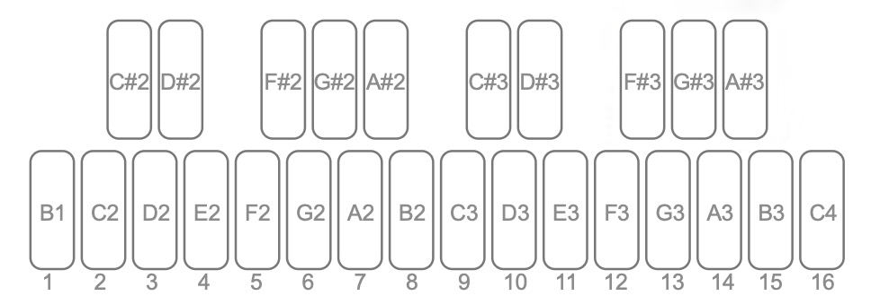
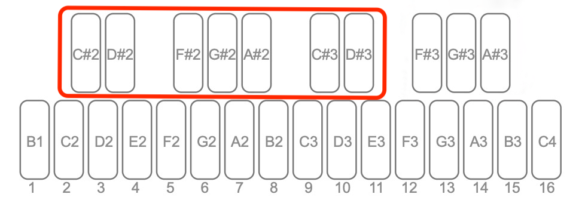

# DONNER ESSENTIAL B1 V1.2.0 Feature Guide

[简体中文](USER-GUIDE-ZH.md)

Use this guide alongside the original Essential B1 manual. It covers the features and controls introduced in firmware V1.2.0.

- [Pattern randomization](#1-pattern-randomization)
- [Song Mode](#2-song-mode)
- [BPM Nudge](#3-bpm-nudge)
- [External clock playback rate](#4-external-clock-playback-rate)
- [Global settings](#5-global-settings)
- [Mode switching and HOLD](#6-mode-switching-and-hold)
- [Fixes and compatibility](#7-fixes-and-compatibility)

A Pattern holds up to 16 steps. The numbered white keys select steps or slots, depending on the current mode. For a combination such as **OCT + ▼**, hold the first button and press the second.

## 1. Pattern randomization

Randomize pitch, rests, gate length, accent, ratchet, or slide independently. Enable the categories you want to change.

1. Start playback in regular Pattern mode.
2. Press **PLAY/STOP + REC/EDIT**. The display flashes `rnd`.
3. Select the categories you want to randomize and adjust their settings.
4. Press **REC/EDIT** to randomize once. The result plays immediately and the randomization screen closes.
5. Use **SAVE** to keep the result.

Press **PLAY/STOP** to leave the screen and continue playback without running another randomization. Randomization is available during regular Pattern playback. An incoming Program Change closes the screen without running randomization.

### Select categories

| Button | Category |
|---|---|
| **PATTERN** | Pitch |
| **CLEAR/REST** | Rest |
| **GATE LENGTH** | Gate length |
| **ACCENT** | Accent |
| **RATCHET** | Ratchet |
| **SLIDE** | Slide |

A steady light means the category is enabled. A flashing light marks the enabled category you are editing. An unlit button marks a disabled category.

Press a steadily lit button to edit its category. Press a flashing button to disable that category. Press an unlit button to enable and edit its category. When all categories are disabled, **REC/EDIT** goes dark. Press **PLAY/STOP** to exit.

### Set pitch, scale, and octave range

Select **PATTERN** so it flashes. Choose a scale with the following keys.

| Key | Scale |
|---|---|
| **B1** | Chromatic |
| **C2** | Major |
| **C♯2** | Whole Tone |
| **D2** | Dorian |
| **D♯2** | Minor Pentatonic |
| **E2** | Phrygian |
| **F2** | Lydian |
| **F♯2** | Melodic Minor (ascending) |
| **G2** | Mixolydian |
| **G♯2** | Harmonic Minor |
| **A2** | Natural Minor |
| **A♯2** | Phrygian Dominant |
| **B2** | Locrian |

Choose the root note with the corresponding key from **C3** through **B3**. To set the octave range, hold **OCT** and press **▲** or **▼**, use **▲ / ▼** to select 1–4, then press **OCT** again to return to `rnd`. The default is 2. A higher setting gives the generator a wider range of notes from the chosen scale.

Press **C4** for Chaos. This uses the original pitch randomizer without scale or octave limits. Pitch randomization applies to all steps, including pitches stored on rest steps. Press **REC/EDIT** to generate new pitches after changing the settings.

### Select steps and set probability

Rest, gate length, accent, ratchet, and slide each have their own step selection and probability. Select a category and use **white keys 1–16** to toggle individual steps. A blue light marks an included step. Steps left unselected retain their values for that category.

| Key | **C♯2** | **D♯2** | **F♯2** | **G♯2** | **A♯2** | **C♯3** | **D♯3** | **F♯3** | **G♯3** | **A♯3** |
|---|---|---|---|---|---|---|---|---|---|---|
| Probability | 10% | 20% | 30% | 40% | 50% | 60% | 70% | 80% | 90% | 100% |

For rest, accent, and slide, the probability determines whether each selected step is set to on. For example, at 30% accent probability, each selected step has a 30% chance of getting an accent. The other selected steps are set to off.

For gate length and ratchet, the probability determines whether each selected step receives a new value between MIN and MAX. If the probability check misses, the step keeps its previous value.

### Set gate length and ratchet limits

1. Select **GATE LENGTH** or **RATCHET** so it flashes.
2. Hold **OCT + ▼** to edit MIN, or **OCT + ▲** to edit MAX.
3. Use **▲ / ▼** to adjust the value shown on the display.
4. Press **OCT** to confirm and return to the randomization screen.

| Category | Range | Default MIN–MAX | Default probability |
|---|---|---|---|
| **GATE LENGTH** | 1–7 | 1–7 | 100% |
| **RATCHET** | 1–4 | 1–4 | 10% |

Set MIN and MAX to the same number to use a fixed value whenever the probability check succeeds. MIN must be at or below MAX. Ratchet has no effect during playback on a step with Slide enabled or on a tied step.

### Try randomizing accents

Play a Pattern and open the randomization screen. Enable only **ACCENT**, select the steps to vary, then press **F♯2** for 30%. Press **REC/EDIT** to hear the result. This changes only the accent state of the selected steps.

### Save or reload a Pattern

Press **SAVE** twice to save to the current location. To save elsewhere, press **SAVE**, use **▲ / ▼** to choose a location from 1 to 128, then press **SAVE** again. To reload the saved Pattern during regular Pattern playback, hold **PATTERN** for about two seconds. Reloading discards unsaved changes.

Randomization settings apply across all Patterns and are retained after power-off. Save each generated Pattern manually to keep it. Initially, all six categories are enabled, the scale is Chromatic, the root is C, the octave range is 2, and all steps are selected in the five categories that support step selection. Gate length starts at 100% probability and the other four start at 10%.

## 2. Song Mode

Song Mode has seven Banks, A through G, with 16 slots each for a total of 112 slots. Each Slot points to one of the 128 stored Patterns.

| Bank | A | B | C | D | E | F | G |
|---|---|---|---|---|---|---|---|
| Key | **C♯2** | **D♯2** | **F♯2** | **G♯2** | **A♯2** | **C♯3** | **D♯3** |

The active Bank key lights up. Bank A is selected the first time you enter Song Mode. **White keys 1–16** select slots within the active Bank.

### Enter, edit, and play

1. Stop playback and press **PATTERN** twice to enter Song Mode. The Pattern assigned to Slot 1 loads automatically.
2. If **SAVE** flashes, the current Pattern has unsaved changes. Save it to keep your edits. To discard them, press **PATTERN** twice again while **SAVE** flashes.
3. Select a Bank and press one of **white keys 1–16** to select a Slot. The selected Slot flashes blue and its Pattern number appears on the display.
4. Use **▲ / ▼** to assign a Pattern from 1 to 128. To add a Slot, press the first unlit white key immediately to the right of the last lit Slot, then choose a Pattern.
5. Press **PLAY/STOP** to play. With CHAIN off, use the white keys to select slots manually.
6. Press **PATTERN** twice to exit. CHAIN turns off when you exit.

Slot settings save automatically as you edit them. Hold **CLEAR/REST** to clear all slots in the current Bank. Use **SAVE** for changes to the Pattern itself.

### CHAIN and GLOBAL TEMPO

Press **A♯3** to toggle CHAIN. With CHAIN on, the assigned slots in the current Bank play in sequence. The chain spans Slot 1 through Slot 16 of that Bank.

Press **G♯3** to toggle GLOBAL TEMPO. When **G♯3** lights up, all Patterns play at the shared tempo. Tap **TEMPO TAP** repeatedly to set it quickly, or press **TEMPO TAP** once and adjust with **▲ / ▼**.

[Donner Song Mode instructions](https://www.donnermusic.com/support/faq/detail?id=184)

### Transpose during playback

While a Pattern plays in Song Mode, hold **PATTERN** to bring up the regular playback controls. Press a key to transpose. Press **C3** (white key **9**) to return to the original pitch.

| White key | **2** | **3** | **4** | **5** | **6** | **7** | **8** | **9** | **10** | **11** | **12** | **13** | **14** | **15** | **16** |
|---|---|---|---|---|---|---|---|---|---|---|---|---|---|---|---|
| Note | **C2** | **D2** | **E2** | **F2** | **G2** | **A2** | **B2** | **C3** | **D3** | **E3** | **F3** | **G3** | **A3** | **B3** | **C4** |
| Semitones | −12 | −10 | −8 | −7 | −5 | −3 | −1 | 0 | +2 | +4 | +5 | +7 | +9 | +11 | +12 |

Use the black keys for the intervening sharps. The lights work as in regular Pattern playback. Notes transposed outside the CV output range may be muted.

### Change sequence length during playback

While a Pattern plays in Song Mode, hold **PATTERN + PLAY/STOP** and press one of **white keys 1–16** to set the length. For example, press **8** to shorten or extend the sequence to eight steps immediately. The length adjustment is retained when switching Patterns. Use **SAVE** to store transpose and length edits with the Pattern.

## 3. BPM Nudge

With the internal clock running a sequence or arpeggio, hold **PLAY/STOP + ▲** to speed up or **PLAY/STOP + ▼** to slow down. The change increases while held, up to 10% in either direction. The display flashes the current BPM. Release the buttons to return smoothly to the original tempo.

At 120 BPM, the temporary range is approximately 108–132 BPM. MIDI Clock and SYNC OUT follow the temporary tempo so connected devices can follow the B1.

## 4. External clock playback rate

While following an external clock and playing a sequence or arpeggio, hold **PLAY/STOP** and use **▲ / ▼** to select a playback rate. The display shows the selected multiplier.

| Multiplier | Playback speed |
|---|---|
| 1/2 | Half speed |
| 1 | Normal speed |
| ×2 | Double speed |

This works with DIN MIDI, USB MIDI, and TRIG (SYNC IN). In AUTO, it applies while the B1 is following an external clock. The multiplier resets to 1 when you start sequence playback or enter ARP mode. The multiplier controls audible playback speed relative to the configured clock.

## 5. Global settings

Stop playback in Pattern mode, then hold **REC/EDIT** to open global settings. Keep holding it while you select a parameter and choose a value. Release **REC/EDIT** to return to the previous screen. Global settings save automatically and are retained after power-off.

| Select with | Parameter |
|---|---|
| **C♯3** | MIDI IN Channel |
| **D♯3** | MIDI OUT Channel |
| **F♯3** | Clock Source |
| **G♯3** | Clock Division (Rate) |
| **A♯3** | Polarity |

The parameter keys flash. The selected key stays lit. The display shows the parameter name for about 2.5 seconds, then shows its value. Blue lights indicate available choices. The active choice lights up blue and white.

### MIDI channels

Select MIDI IN with **C♯3** or MIDI OUT with **D♯3**, then press one of **white keys 1–16** to select the corresponding channel. The display shows the channel number. To receive on all channels, select **ALL** for MIDI IN in the desktop software. The B1 displays ALL when this setting is active.

### Clock source

Press **F♯3**, then select a source.

| White key | Source | Use |
|---|---|---|
| **1** | INTERNAL | Use the B1 internal clock |
| **2** | DIN | Follow MIDI Clock at MIDI IN |
| **3** | USB | Follow USB MIDI Clock |
| **4** | TRIG (SYNC) | Follow pulses at SYNC IN |
| **5** | AUTO | Select the clock source automatically |

### Clock division (Rate)

Press **G♯3**, then select the pulse format. Match the format on both devices when using SYNC IN or SYNC OUT.

| White key | Rate | Display | Pulses |
|---|---|---|---|
| **1** | 2 PPQN | 2 | Two per quarter note |
| **2** | 1 PPS (4 PPQN) | 4 | One per step |
| **3** | 24 PPQN | 24 | 24 per quarter note |
| **4** | 48 PPQN | 48 | 48 per quarter note |

### Sync polarity

Press **A♯3**, then press **white key 1** for Rise or **white key 2** for Fall. Select the rising or falling edge to match the connected device.

## 6. Mode switching and HOLD

During Pattern playback, pressing **ARP** or **REC/EDIT** makes **PLAY/STOP** flash. Press the same button again while it flashes to stop the sequence and enter ARP or sequence editing.

In ARP mode with HOLD off, press **PLAY/STOP** to switch to sequence playback, or **REC/EDIT** to switch to sequence editing.

In ARP mode with HOLD on, press **PLAY/STOP** or **REC/EDIT** to make the **ARP** and **HOLD** lights flash. Press **PLAY/STOP** or **REC/EDIT** again while they flash to confirm the requested switch. You can also press **PATTERN** twice, with the second press while those lights flash, to switch to Pattern mode.

During sequence playback, holding **HOLD** on a TIE step now retriggers the envelope repeatedly so the sound continues. Release **HOLD** to resume normal playback.

## 7. Fixes and compatibility

- Corrected the discrepancy between internal clock speed and the displayed BPM.
- Improved Korg Volca synchronization at specific sync rates and polarities, addressing audio issues and occasional skipped steps.
- Improved recognition of 2 PPQN sync output pulses by external devices.
- Fixed an issue where buttons could stop responding after disconnecting SYNC IN during playback with the TRIG clock source.
- Fixed a macOS connection issue that previously required a power cycle for the B1 to be recognized.
