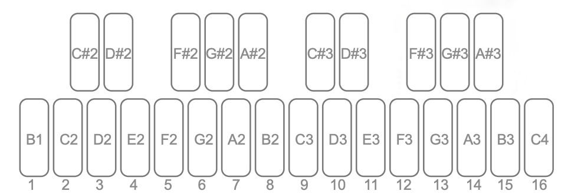
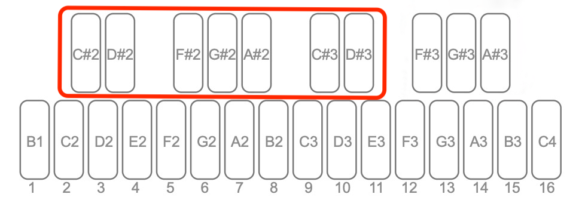

# DONNER ESSENTIAL B1 V1.2.0 新增功能使用指南

[English](USER-GUIDE-EN.md)

本指南介绍 V1.2.0 的新增功能和操作，供 B1 用户配合原版用户手册使用。

## 1. 先了解本次更新

| 想做什么 | 使用功能 | 阅读章节 |
|---|---|---|
| 保留原旋律，只改变节奏或演奏细节 | 六类参数独立随机 | 第 3 章 |
| 生成符合指定主音和音阶的新旋律 | 音高随机、音域与 Chaos | 第 3 章 |
| 在 Song Mode 中组织更多内容 | A–G 共 7 个 Bank、每 Bank 16 个 Slot | 第 4 章 |
| 在 Song Mode 播放时改变音高和长度 | 实时移调、音序长度调整 | 第 4 章 |
| 临时推快或放慢，手动与其他音乐对拍 | BPM Nudge | 第 5 章 |
| 跟随外部时钟时切换节奏倍率 | 外部时钟 Rate 切换 | 第 6 章 |
| 直接在机身调整 MIDI 与同步参数 | 全局设置页面 | 第 7 章 |

## 2. 按键与名词

- **Pattern（音序）**：一段最多 16 步的音符及演奏参数。
- **Step（步进）**：音序中的一个位置；面板下排 16 个白键上的数字 1–16 用于选择步进。
- **Bank／Slot**：Song Mode 的存储组／槽位。它们与 Pattern 编号是不同概念。
- **组合键**：“按住 A + B”表示先按住 A，再按 B。**▲**、**▼**分别指面板上、下方向键。
- **琴键名称**：本指南的 **C2**、**C♯2** 等对应随附键位图；♯表示升号。随机页面会改变琴键用途，请按当前编辑类别操作。

## 3. Pattern 随机化：决定哪些内容可以改变

随机化可以分别处理音高、休止、门长、重音、快速连音和滑音。只启用希望改变的类别，其他类别保持原样。

### 3.1 完成一次随机

1. 在常规 Pattern 模式开始播放音序。
2. 按 **PLAY/STOP + REC/EDIT** 进入随机页面，数码管闪烁显示 `rnd`。
3. 选择参与随机的类别，按需要设置主音、音阶、步进、概率或数值范围。
4. 按 **REC/EDIT** 执行一次随机。新内容立即参与播放，页面自动退出。
5. 如果满意，按本章末尾的 **SAVE** 流程保存。

若本次不想执行，按 **PLAY/STOP** 退出随机页面，播放继续。这个退出操作不会撤销之前已经执行过的随机。

**适用范围**：仅在音序播放时进入；Song Mode 中不能进入。页面收到外部 Program Change（音色／程序切换）消息时，会不执行随机并自动退出。

### 3.2 用六个类别键选择随机内容

| 类别键 | 控制内容 |
|---|---|
| **PATTERN** | 音高：主音、音阶、音域或 Chaos |
| **CLEAR/REST** | 哪些步休止 |
| **GATE LENGTH** | 音符门长 |
| **ACCENT** | 重音开／关 |
| **RATCHET** | 单步快速连音次数 |
| **SLIDE** | 滑音开／关 |

类别键的灯光表示：**常亮＝参与随机；闪烁＝参与随机且正在编辑；熄灭＝不参与随机**。

- 点击常亮的类别键：切换到该类别进行编辑。
- 再次点击正在闪烁的类别键：关闭该类别。
- 点击熄灭的类别键：重新启用并编辑该类别。

想关闭一个常亮类别时，需先点一下切换至该类别，再点一下关闭。全部类别关闭后，**REC/EDIT** 灯熄灭，无法执行随机；按 **PLAY/STOP** 退出。

### 3.3 音高：选择主音、音阶和音域

让 **PATTERN** 类别键闪烁后，按以下键位配置音高随机。

**选择音阶（Scale）**

| 琴键 | 音阶 |
|---|---|
| **B1** | Chromatic／半音阶 |
| **C2** | Major／大调 |
| **C♯2** | Whole Tone／全音阶 |
| **D2** | Dorian／多利亚 |
| **D♯2** | Minor Pentatonic／小调五声音阶 |
| **E2** | Phrygian／弗里几亚 |
| **F2** | Lydian／利底亚 |
| **F♯2** | Melodic Minor／旋律小调（上行形式） |
| **G2** | Mixolydian／混合利底亚 |
| **G♯2** | Harmonic Minor／和声小调 |
| **A2** | Minor／自然小调 |
| **A♯2** | Phrygian Dominant／弗里几亚属音阶 |
| **B2** | Locrian／洛克里亚 |

**选择主音（Key）**

按 **C3** 至 **B3** 中对应音名的琴键，选择 C、C♯、D、D♯、E、F、F♯、G、G♯、A、A♯或 B。

**调整音域（Octave）**

1. 按住 **OCT**，按 **▲或▼** 进入音域编辑。
2. 使用 **▲／▼** 选择 **1–4**。
3. 再按 **OCT** 确认，返回 `rnd` 显示。

默认音域为 2。数值越大，随机音符可分布的音域越宽。例如，设为 1 时从一个八度内选取音符，设为 2 时从两个八度内选取。生成的音符仍符合所选音阶。

**使用 Chaos**

按 **C4** 选择 Chaos，使用原始音高随机方式，不受所选音阶和音域限制。

音高随机作用于当前 Pattern 的全部步进，包括休止步所保存的音高；音高类别不提供逐步选择。仅修改主音或音阶配置，不会立即改变音序，须按 **REC/EDIT** 执行。

### 3.4 休止、门长、重音、快速连音和滑音

这五类各自拥有独立的步进选择与概率设置。

**选择步进**：让对应类别键闪烁后，点击下排 **1–16 号白键**，切换该步是否参与。选中亮蓝灯，未选中熄灭。未选中的步保留该类别的原始内容。

**设置概率**：使用上排 10 个黑键，自左向右对应以下数值。

| 琴键 | **C♯2** | **D♯2** | **F♯2** | **G♯2** | **A♯2** | **C♯3** | **D♯3** | **F♯3** | **G♯3** | **A♯3** |
|---|---|---|---|---|---|---|---|---|---|---|
| 概率 | 10% | 20% | 30% | 40% | 50% | 60% | 70% | 80% | 90% | 100% |

对于**休止、重音和滑音**，概率表示随机后该步为“开启”的概率；未命中会设为“关闭”。例如重音 30% 表示每个选中步有 30% 的概率开启重音。

对于**门长和快速连音**，命中概率后，在所设 MIN–MAX 范围内生成数值；未命中时保持该步原值。

### 3.5 设置门长与快速连音的上下限

1. 选择 **GATE LENGTH** 或 **RATCHET** 类别，使其闪烁。
2. 按住 **OCT + ▼** 编辑最小值 MIN；按住 **OCT + ▲** 编辑最大值 MAX。
3. 使用 **▲／▼** 调整数值，数码管显示正在编辑的值。
4. 按 **OCT** 确认，返回随机页面。

| 类别 | 范围 | 初始 MIN–MAX | 初始概率 |
|---|---|---|---|
| **GATE LENGTH** | 1–7 | 1–7 | 100% |
| **RATCHET** | 1–4 | 1–4 | 10% |

MIN 不能大于 MAX。将两者设为同一个值，可以固定随机命中后的数值。

当该步启用了 Slide 或为 TIE 时，即使保存了快速连音数值，播放时也不会产生快速连音效果。

### 3.6 试一试：保留旋律，只生成重音变化

1. 播放一个已有 Pattern，进入随机页面。
2. 关闭 **PATTERN**、**CLEAR/REST**、**GATE LENGTH**、**RATCHET**、**SLIDE**，仅保留 **ACCENT**。
3. 选择想要处理的步进；按 **F♯2** 将重音概率设为 30%。
4. 按 **REC/EDIT** 执行，试听重音分布。
5. 满意后保存；想继续尝试，可再次进入并执行随机。

本例只改写所选步的重音状态，音高、休止、门长、快速连音与滑音保留。

### 3.7 保存结果与恢复已存版本

**保存当前 Pattern**：按 **SAVE** 进入保存页面，再按 **SAVE** 确认。若要保存到其他位置，第一次按 **SAVE** 后用 **▲／▼** 选择 Pattern 位置（1–128），再按 **SAVE** 确认；这会写入所选位置。

**恢复当前槽位已保存的内容**：在常规 Pattern 播放页面，长按 **PATTERN 约 2 秒**重新载入。此操作会丢弃当前未保存修改，并非逐次撤销。

随机设置与随机结果分开保存：类别开关、音阶、主音、音域、步进、概率及上下限为全局设置，在所有 Pattern 间共用，重启后保留；执行随机后生成的音序仍需手动 **SAVE**。

首次使用的默认值为：六类全部参与，音阶 Chromatic，主音 C，音域 2；五类步进全部选中；休止、重音、快速连音、滑音概率各 10%，门长概率 100%。

## 4. Song Mode：更多槽位与实时演奏控制

### 4.1 A–G 七个 Bank，共 112 个 slots

V1.2.0 将 Song Mode 扩展为 **7 个 Bank × 每 Bank 16 个 slots，共 112 个 slots**。每个 Slot 是一个编排位置，指定一个已存储的 Pattern。它与设备的 128 个 Pattern 存储位置是不同概念。

| Bank | A | B | C | D | E | F | G |
|---|---|---|---|---|---|---|---|
| 选择键 | **C♯2** | **D♯2** | **F♯2** | **G♯2** | **A♯2** | **C♯3** | **D♯3** |

在 Song Mode 中按对应黑键切换 Bank。当前 Bank 的按键灯点亮；初次进入时选择 Bank A（**C♯2**）。下排 **1–16 号白键**用于当前 Bank 的 Slot 1–16。

### 4.2 进入、编辑与调用

1. 停止 Pattern 播放，**双击 PATTERN** 进入 Song Mode。进入后会自动载入 Slot 1 指定的 Pattern。
2. 如果当前 Pattern 有未保存修改，**SAVE** 灯会闪烁提示。想保留修改，应先保存 Pattern；若确定放弃，可在 **SAVE** 灯闪烁期间再次双击 **PATTERN** 确认进入。
3. 选择 Bank，再按 **1–16 号白键**选择一个已有 Slot。所选 Slot 蓝灯闪烁，数码管显示其 Pattern 编号。
4. 用 **▲／▼** 从 1–128 中选择该 Slot 指定的 Pattern。
5. 新增 Slot 时，点击最后一个亮灯 Slot 右侧紧邻的第一个未亮白键，再选择 Pattern 编号。
6. 按 **PLAY/STOP** 播放。CHAIN 关闭时，可用白键手动选择当前 Bank 中的 Slot。
7. 双击 **PATTERN** 退出 Song Mode；退出后 CHAIN 自动关闭。

Slot 设置实时自动保存。要清除当前 Bank 的全部 slots，请长按 **CLEAR/REST**。若修改了 Pattern 的音序内容，请按第 3.7 节的 **SAVE** 流程保存 Pattern。

### 4.3 CHAIN 与统一速度

**CHAIN：按 A♯3 开／关。** 开启后，当前 Bank 中已设置的 slots 依次自动切换；关闭后，手动选择 Slot。Chain 的范围仅限当前 Bank 的 Slot 1–16，不会将 Bank A–G 自动连接成 112 个 slots 的长链。

**GLOBAL TEMPO：按 G♯3 开／关。** 开启时，**G♯3** 灯点亮，所有 Pattern 按统一速度播放，忽略各 Pattern 自身的速度。反复点击 **TEMPO TAP** 可快速设置速度；也可按一次 **TEMPO TAP**，再使用 **▲／▼** 调整数值。

例如，在 Bank A 的 Slot 1–4 分别指定四个 Pattern，开启 CHAIN，即可自动按这四个位置的顺序播放。切换 Bank 可以使用另一组 slots。

[Donner 官方 Song Mode 操作说明](https://www.donnermusic.com/support/faq/detail?id=184)

### 4.4 播放时实时移调

在 Song Mode 正在播放 Pattern 时，按住 **PATTERN** 调出常规音序播放页面，再按琴键实时移调。白键 **2–16** 的对应关系如下；中间的 **C3（9 号白键）**为原调，按它可回到 0 半音。

| 白键编号 | 2 | 3 | 4 | 5 | 6 | 7 | 8 | 9 | 10 | 11 | 12 | 13 | 14 | 15 | 16 |
|---|---|---|---|---|---|---|---|---|---|---|---|---|---|---|---|
| 琴键 | **C2** | **D2** | **E2** | **F2** | **G2** | **A2** | **B2** | **C3** | **D3** | **E3** | **F3** | **G3** | **A3** | **B3** | **C4** |
| 半音偏移 | -12 | -10 | -8 | -7 | -5 | -3 | -1 | 0 | +2 | +4 | +5 | +7 | +9 | +11 | +12 |

半音移调遵循原有键盘音程关系，黑键用于相邻的升音位置；灯光提示与常规 Pattern 播放时一致。若移调超出本机 CV 输出范围，对应音符可能静音。

### 4.5 播放时调整音序长度与保存

在 Song Mode 正在播放 Pattern 时，按住 **PATTERN + PLAY/STOP**，点击 **1–16 号白键**设置音序长度。例如选择 8 号键，音序立即改为 8 步。

长度调整实时生效，切换 Pattern 后保留。实时移调与长度修改的保存对象为 **Pattern 本身**；希望保留这些音序修改时，仍需执行 Pattern **SAVE**。

## 5. BPM Nudge：临时推快或放慢

当 B1 使用内部时钟播放音序或琶音时，可用 BPM Nudge 手动微调速度，与其他音乐对拍。

1. 按住 **PLAY/STOP + ▲** 临时推快；按住 **PLAY/STOP + ▼** 临时放慢。
2. 持续按住时，速度变化逐步增加，最大为原 BPM 的 **±10%**。
3. 调整期间，数码管闪烁显示当前 BPM。
4. 松开后，速度平滑回到原 BPM，不改变原来的 BPM 设置。

例如原 BPM 为 120 时，临时变化范围最多约为 108–132 BPM。B1 输出的 MIDI Clock 与 SYNC OUT 会跟随临时变速，让由 B1 提供时钟的设备同步调整。

**B1 接收外部时钟时不启用 BPM Nudge**；相同组合键用于下一章的外部时钟倍率切换。

## 6. 外部时钟：播放中切换半速／原速／双倍速

当 B1 跟随外部时钟播放音序或琶音时，按住 **PLAY/STOP** 并使用 **▲／▼**，在以下三档实际播放速度间切换。数码管显示当前档位。

| 档位 | 听到的效果 |
|---|---|
| 1/2 | 以基准播放速度的一半运行 |
| 1 | 恢复基准播放速度 |
| ×2 | 以基准播放速度的两倍运行 |

此功能适用于 DIN MIDI、USB MIDI 和 TRIG（SYNC IN）外部时钟；使用 AUTO 时，在 B1 实际跟随外部时钟的情况下使用。

这个倍率是临时设置，每次开始播放音序或进入 ARP 模式时恢复为 1。三档表示实际听到的速度倍率，与全局设置中的 2／4／24／48 等同步脉冲规格分开理解。

## 7. 机身全局设置

### 7.1 进入与退出

在 **PATTERN 模式**下停止音序播放，然后长按 **REC/EDIT** 进入全局设置。保持按住 **REC/EDIT**，用琴键选择参数并修改数值。松开 **REC/EDIT** 即返回原页面。全局设置自动保存，断电后仍会保留。

| 参数选择键 | 设置项 | 用途 |
|---|---|---|
| **C♯3** | MIDI IN Channel | 设置 MIDI 输入通道 |
| **D♯3** | MIDI OUT Channel | 设置 MIDI 输出通道 |
| **F♯3** | Clock Source | 选择时钟来源 |
| **G♯3** | Clock Division／Rate | 设置时钟分频／速率 |
| **A♯3** | Polarity | 设置同步信号极性 |

### 7.2 灯光与数码管提示

- 5 个参数选择键闪烁，当前选中的参数键常亮。
- 选择参数后，数码管先显示参数名称约 2.5 秒，再显示当前数值。
- **1–16 号白键**用于选择数值；可用值对应蓝灯常亮，当前值对应蓝灯与白灯一起常亮。

### 7.3 MIDI 输入／输出通道

- 按住 **REC/EDIT**，按 **C♯3** 选择 MIDI IN Channel，再按 **1–16 号白键**设置输入通道 1–16。
- 按住 **REC/EDIT**，按 **D♯3** 选择 MIDI OUT Channel，再按 **1–16 号白键**设置输出通道 1–16。
- 要接收所有 MIDI 通道，请在上位机软件中将 MIDI IN Channel 设为 **ALL**。B1 的全局设置页面会显示 ALL 状态。
- 数码管显示对应通道编号。与外部设备交换音符等通道消息时，应匹配双方 MIDI 通道。

### 7.4 时钟源（Clock Source）

按住 **REC/EDIT**，按 **F♯3**，再用以下白键选择。

| 白键编号 | 时钟源 | 使用场景 |
|---|---|---|
| 1 | INTERNAL | 使用 B1 内部时钟 |
| 2 | DIN | 跟随 MIDI IN 接口输入的 MIDI 时钟 |
| 3 | USB | 跟随 USB MIDI 时钟 |
| 4 | TRIG（SYNC） | 跟随 SYNC IN 输入的同步脉冲 |
| 5 | AUTO | 自动时钟源模式 |

### 7.5 时钟分频／速率（Clock Division／Rate）

按住 **REC/EDIT**，按 **G♯3**，再用以下白键选择同步脉冲规格。

| 白键编号 | 规格 | 数码管数值 | 含义 |
|---|---|---|---|
| 1 | 2 PPQN | 2 | 每四分音符 2 个脉冲 |
| 2 | 1 PPS（4 PPQN） | 4 | 每步 1 个脉冲 |
| 3 | 24 PPQN | 24 | 每四分音符 24 个脉冲 |
| 4 | 48 PPQN | 48 | 每四分音符 48 个脉冲 |

与其他设备通过 SYNC IN／OUT 连接时，双方应使用匹配的脉冲规格。此处设置同步基准，第 6 章的倍率快捷操作用于播放中的临时速度变化。

### 7.6 同步极性（Polarity）

按住 **REC/EDIT**，按 **A♯3**，再按 **1 号白键**选择 Rise，或按 **2 号白键**选择 Fall，分别对应上升沿与下降沿同步。按外部设备的同步要求选择。

## 8. 模式切换与 HOLD 改进

### 8.1 Pattern 播放中的切换确认

播放 Pattern 时，第一次按 **ARP** 或 **REC/EDIT**，**PLAY/STOP** 灯闪烁提示；在闪烁期间，再按一次相同的目标键，才中断音序并进入 **ARP** 或音序编辑模式。一次误触不会立即中断播放。

### 8.2 从 ARP 切换至音序

ARP 模式下，HOLD 未开启时，按 **PLAY/STOP** 可直接切换至音序并播放，按 **REC/EDIT** 可切换至音序编辑。

HOLD 开启时，按 **PLAY/STOP**（或 **REC/EDIT**），**ARP** 与 HOLD 灯闪烁提示；在灯光闪烁期间再次按 **PLAY/STOP**（或 **REC/EDIT**），切换至 Pattern 模式并播放音序（或编辑音序）。按 **PATTERN** 也会使 **ARP** 与 **HOLD** 灯闪烁。在闪烁期间再次按 **PATTERN**，即可切换至音序模式。

### 8.3 HOLD 对 TIE 步的表现

在音序播放中，按住 **HOLD** 保持当前步时，即使该步为 TIE 延音，包络也会重复触发，避免声音因包络持续衰减而逐渐消失。松开 **HOLD** 后恢复正常音序播放。

## 9. 修复与兼容性改进

- 修正内部时钟实际速度与显示 BPM 的偏差。
- 改善与 Korg Volca 系列连接时，在特定同步速率与极性下的声音异常和偶发丢步。
- 优化 2 PPQN 的同步输出脉冲，改善外部设备的识别可靠性。
- 修复以 TRIG 为时钟源播放时，断开 SYNC IN 后可能出现按键无响应的问题。
- 修复 macOS 连接后需要重新上电才能识别的问题。
